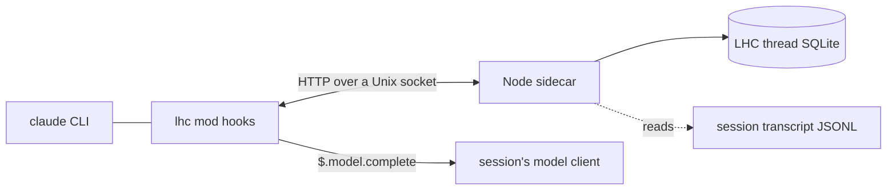

# Host: cc-lhc-mod

Last verified against code: 2026-11-03, Claude Code 2.1.317, main at `b15857f`. Precedence when facts disagree: code, then the package README (`packages/cc-lhc-mod/README.md`), then this document.

This document builds on the vocabulary in [01-core-concepts.md](01-core-concepts.md) and [02-domain-design.md](02-domain-design.md). Record, event, derivation, view, band, compact point, visibility boundary, impression, and retrieval keep their SDK meanings here.

## Host position

`cc-lhc-mod` (`packages/cc-lhc-mod`) is LHC for plain `claude`. A person starts the Claude Code CLI with the plugin, and nothing wraps the process. The plugin is a Claude Code mod named `lhc`. The mod starts one Node sidecar per Claude process, and the sidecar holds the LHC SDK instance.

The LHC thread is the record. The Claude Code session holds only a projection of it. When Claude Code compacts, for any reason, the mod answers with the LHC view of the thread, and Claude Code installs that view in place of its own summary. The session id never changes. Background shells, agents, monitors, and typed-ahead input survive every compaction, because nothing is swapped.

This host replaces [cc-lhc](05-host-cc-lhc.md) for interactive use. cc-lhc owns Claude under a PTY and compacts only at a settled seam, by starting a new Claude process on a rebuilt session file. A mod hook sits inside Claude Code's own compaction, so this host can compact in the middle of a turn. [claude-lhc](06-host-claude-lhc.md) stays the host for the Agent SDK and for t3code. The desktop app and the SDK have no `$.process`, so the mod cannot start its sidecar there.

## Architecture

The mod (`mod/hooks/`, bundled to `dist/plugin/hooks/register.js`) runs in Claude Code's mod sandbox, which has no Node. It holds no durable state. It turns engine events into sidecar calls and draws the panel and the status line. `register.ts` wires the hooks.

The sidecar (`sidecar/src/`, bundled to `dist/plugin/sidecar/main.js`) is Node 24. The mod starts it with `node` from `PATH` when the module loads (`mod/hooks/sidecar.ts`), and Claude Code kills it with the module. It listens on `<LHC home>/run/<load id>.sock` in a mode 0700 directory. It owns capture, recovery, the projector, retrieval, and the thread lease. The mod owns the compact policy and sends the target and the guard with each `/compact`, so the sidecar holds no policy of its own.

Pure logic that both sides use is in `src/`: settings, the context estimate, panel state, and paths. The block mapping, retrieval budgets, and the `<recalled-history>` envelope come from `packages/claude-adapter`, which claude-lhc shares.

## Capture

The mod hooks `session.append` on the main loop and records what Claude Code stored, not what was offered (`mod/hooks/capture.ts`). Every row, every `turn.start`, `turn.step`, and `turn.complete`, and every bind go into one ordered outbox. A flush sends the entries in order and drops an entry only after the sidecar answers, and the sidecar answers only after its commit. The hook never waits on the sidecar. After 5 failed sends in a row, capture stops and the transcript shows one notice.

The sidecar maps rows to core intake events (`sidecar/src/capture/map.ts`) into the thread under alias `claude-code:<session id>`. It drops `queue` and `notice` rows, rows with no role, mechanical attachments (`MECHANICAL_ATTACHMENTS`), and rows an install receipt claims. A background job's `<task-notification>` is a `runtime_note`. A queued command is the person's steer. A row a plugin sent, such as the panel's `/compact`, is never the person's prompt. Turn steps come from `turn.step`, because core splits a turn only at a step the host recorded.

Recovery (`sidecar/src/recovery.ts`) reads the transcript JSONL from the committed cursor at every bind and before every compaction. It records what live capture missed through the same mapping, and it restores the open turn the transcript shows. A row that recovery records lands at the end of the record, not in its place.

Claude Code has no rewind event. Recovery finds a rewind from the transcript. A branch off the active chain that holds a person's prompt is abandoned. When a new prompt's path back to the last recorded row passes an abandoned branch, the sidecar writes core `rollback`. A rewind reaches back to a compact boundary but not past it.

## Compact

Claude Code decides when to compact, and LHC decides what the context becomes. The mod hooks `session.compact` on the main loop for `auto`, `manual`, and `plugin` triggers (`mod/hooks/compact.ts`). The hook drains the outbox and posts `/compact` with the target. The sidecar (`sidecar/src/compact.ts`) runs recovery, then calls core `midTurnCompact` when a turn is open or `compact` when the turn is settled. Core's turn parts carry the open turn, so the host forces no turn closed and injects no continuation marker.

The projector (`sidecar/src/projector.ts`) turns the served view into built `SessionMessage`s. It never keeps an engine `handle`, because a handle reloads the full pre-compact history on resume. Thinking blocks are dropped. An image, a document, and an empty tool result become `[image omitted by LHC: m<id>]`, `[document omitted by LHC: m<id>]`, and `[empty tool result: m<id>]`. A tool call the view never answers gets an error result.

Before it answers, the sidecar persists an install receipt (`sidecar/src/receipts.ts`) with one fingerprint per message. Claude Code appends the installed messages back as rows. Live capture and recovery claim those rows against the receipt in order, so the view never becomes record.

The sidecar answers native, and Claude Code runs its own summary, in these cases:

- The view plus the fixed context would still reach the trigger. The mod sends the fixed context, the engine breakdown's `used` rows other than `Messages`, with `/compact`.
- The sidecar is unreachable, the outbox does not drain, or core refuses.

A fallback logs `compact <trigger> fell back to native after <ms>ms: <reason>`, shows `LHC could not compact (...)`, and records the native summary as one labeled `runtime_note`. `precompute` is skipped, and subagent compactions pass through to native.

At the next main-loop step, the mod reads Claude Code's own estimate and logs `post-compact context N trigger T target X ok|inadequate`. Above 75 percent of the trigger it also shows a transcript notice. Claude Code stops a turn after three refills within three turns, so a view that cannot get far enough below the trigger is visible before that happens.

The status line is empty most of the time (`statusLine` in `src/panel.ts`). After an LHC compaction it reads `lhc: <before> → <after>`, such as `lhc: 47k → 22k`, until a turn that began after the compaction ends. After a fallback it reads `lhc: fell back to Claude Code's summary` until the next LHC compaction succeeds. There is no pressure line, because Claude Code's own `N% until auto-compact` already counts toward the LHC trigger. Claude Code puts `⚠` in front of a plugin's status line.

The LHC panel's **prune** posts `/compact` with `op: "prune"`. Core `threadView.prune` moves the visibility boundary, and the view is installed with no core compact.

## Retrieval

The mod registers `mcp__lhc__get_turns` and `mcp__lhc__get_messages` at `session.start` and answers them from a `tool.call` hook (`mod/hooks/retrieval.ts`), so no permission prompt shows in any mode. The sidecar's `/retrieve` route serves them with claude-adapter's budgets: 8,000 tokens, 48,000 bytes, and 32 ids per call. Served content is inside the `<recalled-history>` envelope. Core writes each impression under surface `claude-code:<op>`. A failure reaches the model as the tool's error text.

## Inference

The `inferenceWorker` setting picks the derivation lane when the sidecar starts. `bridge` is the default. The sidecar queues core's model calls with request ids, and a pump on `$.clock.every(1000)` in the mod claims them, at most 3 at a time, and runs each on `$.model.complete`, the session's own client (`mod/hooks/inference.ts`, `sidecar/src/inference-bridge.ts`). An `aborted` completion goes back to the queue and never reaches core as a failure, because core deletes failed items. A reload kills the sidecar, and core puts the dead sidecar's claimed items back in the queue.

`sdk` runs the Agent SDK summary worker inside the sidecar instead (`sidecar/src/inference-sdk.ts`). `LHC_NO_INFERENCE=1` in Claude's environment swaps either lane for deterministic derivations.

## Lifecycle

`classic.SessionStart` posts `/bind` for `startup`, `clear`, `resume`, `fork`, and `compact` (`sidecar/src/bind.ts`). A hot reload re-runs only `session.start`, so the mod keeps its binding in `$.state` and rebinds with source `reload`. A crashed or killed sidecar is started again on the next capture or compaction, and it rebinds with source `restart`. Nothing waits for `session.end`, because `/exit` kills the sidecar first. Each capture batch is committed before the sidecar answers it, so an exit loses nothing that was acknowledged.

A bind answers the thread and how the session came to it. `/lhc status` shows it as `thread <id> (<how>)`:

- `resumed`. A known alias keeps its thread: `/resume`, `--continue`, `--resume`, and a reload.
- `new`. An unknown session gets a new thread: startup, and `/clear`, whose new session id has no alias.
- `forked`. A `--fork-session` records nothing until its first captured row. Then the sidecar finds the source by the rows the fork's transcript shares with a sibling transcript and copies the source thread with core `copyThread`.
- `replaced`. A thread that holds `compact_continuation_boundary` rows, which only older hosts write, is not adopted. The session records to a new thread under alias `cc-lhc-mod:<session id>` and shows a notice that names both threads.

The lease (`sidecar/src/lease.ts`, `<LHC home>/owners/<thread>.json`) holds the Claude process pid. A second live Claude process on the same thread is refused with a notice. A sidecar that exits under a live Claude process keeps the lease, and the next bind takes over a dead owner's lease. The sidecar writes a newline to stdout every 5 seconds and exits with `exit orphaned` when the write fails, so it stops once the Claude process that started it is gone, even after a hangup.

## Settings

The settings are global and follow the live model's window (`src/settings.ts`). Nothing is set per thread. The three `userConfig` fields are `lowerBound` (140,000), `upperBound` (800,000), and `compactPercent` (90). The window W is the compact window (`breakdown.rawMaxTokens`), else the model window.

- trigger = min(`upperBound`, `compactPercent` x W, W - 33,000)
- target = min(`lowerBound`, 0.4 x W, trigger / 2)

Claude Code fires auto-compact at min(floor(e x pct / 100), e - 13,000), where e is W - 20,000. The mod sets `CLAUDE_AUTOCOMPACT_PCT_OVERRIDE` to 100 x trigger / (W - 20,000) and nudges the float until the engine's floor equals the trigger. The override can only lower Claude Code's threshold, so W - 33,000 is the latest trigger. On 1M the defaults give 800k and 140k. On 200k they give 167k and 80k, and the panel shows `Clamped:`. Each bound is at least 10,000 (`MIN_BOUND`).

The settings change through `/config`, the panel, or `/lhc bounds`. A change applies at once and is written with `$.config.set`, which reloads the plugin. `applySettings` runs again on a model change. The `/model` re-apply has unit tests but no live proof yet.

## State

LHC state lives under `$LHC_HOME`, else `~/.lhc` (`src/paths.ts`).

| Path | Purpose |
| --- | --- |
| `registry.sqlite`, `threads/<uuid>.sqlite` | Core registry, alias map, and per-thread record |
| `owners/<thread id>.json` | The thread lease, holding the Claude process pid |
| `cursors/<session id>.json` | The committed transcript offset |
| `receipts/<session id>.json` | The last install receipt |
| `run/<load id>.sock` | The sidecar socket, in a mode 0700 directory |
| `logs/mod-<load id>.log`, `logs/sidecar-<load id>.log` | One pair per module load |
| `exports/<thread>-<time>.json` | `/lhc export` output |

The transcript stays in Claude Code's own home, under `projects/<encoded cwd>/<session id>.jsonl`. It is a projection, never the record.

## Limits

These are the known differences from a full-fidelity record and from cc-lhc. Each is accepted for v2.

- **Thinking and images in the live tail.** A compaction drops thinking blocks from the tail, and images and documents become placeholders. cc-lhc rebuilds thinking `signed_verbatim`. Built tails without thinking passed live and on resume on Sonnet and Opus (stage 1 probe 3). Retrieval serves text only, so a placeholder cannot bring an image back.
- **`tool_reference`.** ToolSearch's `tool_reference` blocks are dropped from the view. Stage 1 probe 3 saw no failure from the loss.
- **One step cannot be split.** If the tool results of a single model step plus the fixed context do not fit under the trigger, the guard refuses the LHC view. An example is six parallel 10k reads against a 60k trigger. Claude Code's own summary then runs once, with the `LHC could not compact (...)` notice and the `⚠ lhc: fell back to Claude Code's summary` line. The CCV2-8 verifier measured about 14 s of API time for the summary and about 70k cache-write tokens on the next request (`.pstack/runs/ccv2/proof/CCV2-8/verifier-2e58664/perf-report.md`). It happens only when a step is large compared with the trigger, and not at the default 800k.
- **The 200k clamp.** Claude Code fires no later than W - 33,000, so a 200k window caps the trigger at 167k whatever the settings say. The panel's `Clamped:` line shows it.
- **Rewind detection by transcript.** Rewind has no event. The sidecar sees it at the next prompt, so a rewind that recovery finds also hides rows recorded live after it. A rewind cannot reach past a compact boundary.
- **Active-exit transcript omission.** When Claude Code exits in the middle of a tool call, its transcript can leave out the cut-off call and its result after live capture recorded them. The record then holds one call and result that Claude dropped, inside a turn closed `aborted` with reason `interrupted`. `helpers/compare.mjs` reports that call as a mismatch until it learns the rule.
- **Recovered rows land at the end.** A row that live capture missed and recovery records sits at the end of the record, not in its place.
- **Desktop app and SDK.** `$.process` is CLI-only. Those hosts stay on claude-lhc.
- **Older threads.** A thread with forced compact boundaries is replaced by a new thread, not migrated.
- **`/compact <instructions>`.** The instructions are recorded as a note, and LHC does not summarize by them.

Later work a user would notice, from the plan's Later work list:

- The plugin is not in a marketplace. Each launch needs `--plugin-dir`.
- Each open session's sidecar uses about 250 to 360 MiB, most of it the token-counting rank table core builds on first count.
- The panel's last compaction is kept in `$.state`, so a Claude Code restart shows none until the next compaction.
- A `/model` switch re-applies the trigger in unit tests only.
- A fork that exits before its first capture commits keeps its source only in memory, so a later `--resume` of it starts a fresh thread.

## Certification

On 2026-11-03 one scripted long task ran under cc-lhc 0.4.5 and under this host, twice each and interleaved, on `claude-sonnet-5-5` with the same bounds. The record is `.pstack/runs/ccv2/proof/CCV2-8/certification.md` in the main checkout. Its table compares task completion, compactions, mid-turn compactions, background jobs, capture completeness, retrieval, wall time, and billed tokens. Both hosts completed the task in every run, with the background job intact, complete capture, and exact retrieval. v2 compacted 4 times per run, all mid-turn. cc-lhc compacted twice, at settled seams, after each turn overshot the trigger by about 25k. v2 billed 8 percent fewer tokens. Its median wall time was 39 percent longer, and the record traces that gap to the shared API upstream's time to first byte, not to host time.

The seam check (`pnpm --filter cc-lhc-mod seam-check`) proves the trigger and the bind seams against each Claude Code release. Run it after every update. The drives are in `.agents/skills/verify-cc-lhc-mod`.
